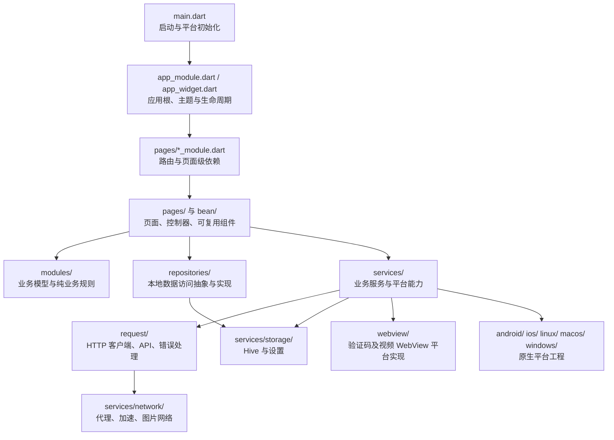
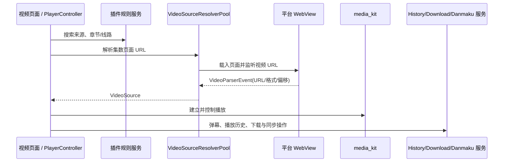

# Kazumi 项目代码架构

本文根据当前仓库代码整理，描述应用启动、模块组织、状态与依赖管理、数据访问、网络、播放及平台集成的实际结构，供阅读代码和规划改动时参考。项目是一个 Flutter/Dart 多平台番剧浏览与播放应用。

## 1. 架构概览

代码以 `lib/` 为主体，整体采用“功能页面 + 领域/数据模型 + 服务基础设施”的混合结构：



这不是严格的 Clean Architecture：部分页面/控制器会直接使用静态 API、`GStorage` 或具体服务；`modules/` 中既有领域模型，也有 Hive 持久化模型和同步规则。新增功能时应优先遵循相邻功能已有的模块与依赖注入方式，而不要假设所有依赖都经过 Repository。

## 2. 启动与应用装配

1. `lib/main.dart` 初始化 Flutter、媒体播放运行时和第三方 HTTP 许可证。
2. 按平台初始化 WebView、系统 UI、桌面窗口等能力。
3. 初始化 Hive 和 `GStorage`。若存储初始化失败，会展示独立的存储错误页面并停止正常启动。
4. 恢复下载目录访问权限，初始化桌面窗口、Windows 系统代理及网络状态，并应用代理配置。
5. 以 `ModularApp` 启动应用，注册 `ThemeProvider`、导航键、路由观察器和 `appModule`。
6. `appModule` 装配两个根模块：
   - `coreModule`：应用级共享 Repository、服务、跨页面控制器。
   - `indexModule`：初始化/引导页面、主导航、播放、详情、设置和搜索等路由模块。

`AppWidget` 负责应用级主题构建、读取已保存的主题设置、生命周期监听，以及托盘、窗口关闭行为和显示模式等平台集成。`navigation.dart` 集中提供根 Navigator / ScaffoldMessenger key 和页面路由观察器。

## 3. 目录与职责

| 路径 | 主要职责 |
| --- | --- |
| `lib/main.dart` | 程序入口、存储/平台预初始化、根应用启动 |
| `lib/app_module.dart`、`lib/core_module.dart` | `flutter_modular` 根模块与应用生命周期级依赖注册 |
| `lib/app_widget.dart`、`lib/navigation.dart` | 根 Widget、主题、窗口/托盘、导航基础设施 |
| `lib/pages/` | 页面、页面控制器、路由模块及页面局部组件；按业务功能组织 |
| `lib/bean/` | 跨页面复用的 UI 组件、弹窗、设置组件、主题 Provider |
| `lib/modules/` | 番剧、收藏、历史、下载、弹幕、评论、搜索等模型及相邻业务规则 |
| `lib/repositories/` | 部分本地业务数据访问接口与 Hive 实现 |
| `lib/request/` | API、HTTP 客户端、端点配置、网络配置及异常类型 |
| `lib/services/` | 存储、下载、网络、播放、规则解析、同步、平台、更新等服务 |
| `lib/plugins/` | 视频源规则/反爬配置及插件集合的 MobX 控制器 |
| `lib/webview/` | 验证码与视频解析 WebView 的控制器及平台实现 |
| `lib/bbcode/` | BBCode 解析器、生成代码和渲染组件 |
| `lib/utils/` | 通用异步控制、媒体/URL/文件/格式等辅助逻辑 |
| `assets/`、`static/`、`licenses/` | 图片、字体、着色器、声明文件及许可证资源 |
| `android/`、`ios/`、`linux/`、`macos/`、`windows/`、`web/` | Flutter 各平台工程与宿主端代码；桌面原生入口可见于 Linux/Windows 等目录 |
| `test/` | Dart/Flutter 测试，重点覆盖规则解析、同步、异步控制及数据逻辑 |

生成文件以 `.g.dart`、`hive_registrar.g.dart` 等形式与源文件并列，主要对应 MobX store 和 Hive adapter；修改时应编辑源声明，而不是手工维护生成文件。

## 4. 路由与功能模块

路由由 `flutter_modular` 的 `createModule`、`route` 和 `module` 组织。`pages/index_module.dart` 是主路由装配点，常见功能路由大致如下：

| 功能 | 代码位置 | 说明 |
| --- | --- | --- |
| 主导航 | `pages/menu/`、`pages/index_module.dart` | 首页菜单及主 Tab；热门、时间表、收藏、我的等页面挂在 Tab 模块下 |
| 搜索 | `pages/search/` | 普通搜索与图片搜索；路由级提供搜索控制器 |
| 番剧详情 | `pages/info/` | 番剧详情、评论、角色、来源选择与验证码流程 |
| 播放 | `pages/video/`、`pages/player/` | 视频页负责页面布局/播放上下文，播放器控制器与多个子控制器负责播放、弹幕、控制面板、截图和同步播放 |
| 收藏/历史/下载 | `pages/collect/`、`pages/history/`、`pages/download/` | 列表页面、查询/呈现组件及对应控制器 |
| 设置 | `pages/settings/` | 主题、播放器、解码器、下载、代理、弹幕、同步、更新等配置 |
| 插件规则 | `pages/plugin_editor/` | 插件目录、编辑、测试、安装/更新界面 |
| 引导与信息 | `pages/onboarding/`、`pages/about/`、`pages/logs/` | 首次使用引导、关于/许可证和日志 |

页面模块按生命周期注册依赖：`coreModule` 中的单例跨页面共享；路由 `provide` 中注册的控制器归路由作用域管理；Tab 模块特意持有热门和时间表控制器，使 Tab 切换期间状态得以保留。路由入口会检查关键参数类型，参数无效时显示专门的路由错误页。

## 5. 状态管理与依赖关系

- **MobX**：页面控制器及插件控制器使用 `Store`、`@observable`、`@computed`、`@action` 等状态机制；`flutter_mobx` 将状态变更呈现到 Widget。生成的 `.g.dart` 文件提供 MobX 实现。
- **Flutter 原生状态**：主题通过 `ChangeNotifier` 风格的 `ThemeProvider` 暴露给根应用；局部简单交互也使用 Flutter Widget 自带状态。
- **依赖注入**：`core_module.dart` 将 Repository 接口实现、下载/音频/同步等应用级服务及跨功能控制器注册为 singleton；页面模块在路由作用域注册页面控制器，再通过 `inject<T>()` 读取共享服务。
- **异步生命周期**：项目在 `utils/` 提供 `AsyncSession`、`AsyncSingleFlight`、`AsyncSerialQueue`、`AsyncRateLimiter` 等工具，用于取消过期任务、合并重复任务、串行化写入或限制请求频率。
- **控制器不是统一基类**：页面控制器通常按具体功能实现；播放器又将播放、弹幕、同步播放、截图、面板、seek 等职责拆分到 `pages/player/controller/` 下的协作控制器。

目前 `coreModule` 显式注册的关键共享依赖包括收藏/搜索历史/历史/下载/弹幕屏蔽 Repository，下载管理器、音频控制器、播放历史服务、着色器资源服务、WebDAV 及弹幕屏蔽同步服务，以及插件、收藏、历史、我的和下载控制器。并非所有服务都通过该模块实例化：部分 API/客户端或服务采用静态成员、工厂/单例，阅读调用点时需检查其真实生命周期。

## 6. 业务模型、数据持久化与 Repository

### 模型与业务规则

`modules/` 按业务主题存放结构化对象和转换/同步逻辑，例如：

- `modules/bangumi/`：番剧、集数、收藏状态、标签、关系、评分/评论数据。
- `modules/collect/`：收藏实体、收藏变更记录、收藏类型与同步合并/计划。
- `modules/history/`、`modules/download/`：历史和下载记录。
- `modules/danmaku/`、`modules/comments/`、`modules/characters/`、`modules/staff/`：弹幕、评论、角色及职员数据。
- `modules/search/`、`modules/plugin/`、`modules/roads/`：搜索响应、插件 HTTP 数据及播放线路模型。

部分模型带 Hive 注解并由生成 adapter 持久化；同步相关的序列化/合并逻辑也放在对应模块或 `services/sync/`。

### 本地存储

`services/storage/storage.dart` 中的 `GStorage` 是 Hive 访问门面，集中初始化及持有 favorites（旧数据兼容）、collectibles、histories、collectChanges、shieldList、setting、searchHistory、downloads 等 Box。它还承载部分带顺序/刷新要求的收藏写操作。设置键及默认值集中在 `settings_keys.dart`，通过带类型的 `SettingKey<T>` 注册表访问。

应用启动时调用 Hive adapter 注册并打开各 Box；存储层包含 Box 损坏恢复流程。应用数据目录由 `path_provider` 提供。插件规则则由 `PluginsController` 从应用支持目录中的 `plugins/v2/plugins.json` 读取和写入，并迁移旧版独立规则文件。

### Repository

`repositories/` 当前包含收藏、收藏 CRUD、历史、下载、弹幕屏蔽和搜索历史等数据访问实现，部分定义接口供页面/控制器依赖注入。实现主要以 `GStorage`/Hive 为后端。Repository 是有价值的边界，但尚未覆盖全部业务：许多 API 请求、设置读取及服务调用仍由控制器直接发起。

## 7. 网络与远端 API

网络层分成 API/客户端配置与横切网络服务：

1. `request/core/` 定义 `NetworkConfig`、Dio 实例工厂、日志拦截器、错误映射及异常类型。
2. `request/clients/` 为 Bangumi、弹幕、插件站点、规则仓库、追踪和下载提供专用客户端。
3. `request/apis/` 将服务端操作封装成 Bangumi、弹幕、插件目录和追踪 API；端点集中在 `request/config/api_endpoints.dart`。
4. `services/network/` 管理应用代理、Windows 系统代理、网络状态、Bangumi 加速/ECH、图片 URL 重写与图片缓存/文件请求。

`DioFactory` 分别缓存 API、Bangumi、规则仓库、插件和下载 Dio 实例，使用设置构造超时、代理和适配器；Bangumi 客户端另接加速拦截器/传输适配器，规则仓库客户端支持镜像切换。插件视频规则执行位于 `services/plugin/`：`RuleEngine` 协调 API/XPath 策略、请求执行、结果解析、验证码和错误分类；业务插件配置由 `plugins/` 管理。

## 8. 视频源、播放器与弹幕

播放链路由页面、解析服务、WebView 和媒体运行时协作：



- `services/video_source/` 定义视频源接口、WebView 实现和解析 worker 池；worker 按 WebView 实例串行解析，并支持租约、取消和资源释放。解析类型区分在线源与缓存源。
- `webview/video/` 通过控制器工厂选择 Android、Apple、Linux、Windows 等平台实现；验证码 WebView 位于 `webview/captcha/`，同样按平台拆分。
- `pages/video/` 处理播放页面、播放参数、侧栏和集数面板；`pages/player/` 及其 `controller/` 负责实际交互与播放器状态。
- `media_kit`/`media_kit_video` 承担媒体播放；`services/player/` 补充音频会话/系统媒体控制、外部播放、PiP、同步播放、截图导出、低内存策略和错误映射等服务。
- 弹幕模型与转换位于 `modules/danmaku/`；获取/屏蔽/同步服务分布在 API、页面播放器控制器以及 `services/sync/`。屏蔽状态支持 WebDAV 同步。

## 9. 同步、下载与其他后台能力

- **同步**：`services/sync/` 包括 Bangumi、历史、弹幕屏蔽同步和 WebDAV 客户端。历史同步使用本地事件日志、设备标识、快照/合并机制；WebDAV 操作使用串行队列，历史同步还使用 single-flight 避免重复并发工作。收藏同步的变更与合并模型位于 `modules/collect/`。
- **下载**：`DownloadManager` 管理任务排队、优先级、暂停/恢复/取消和进度；下载客户端、M3U8 解析/分段处理、下载目录权限恢复及路径迁移位于请求、服务和工具层。下载记录存放于 Hive。
- **更新**：`services/update/` 集中自动更新、启动检查、下载源和下载器实现。
- **着色器/缓存/日志**：资源服务、图片缓存和日志分别位于 `services/shaders/`、`services/storage/` 与 `services/logging/`。

## 10. 平台集成与资源

Flutter UI 之外，项目通过插件及宿主工程适配平台差异：桌面窗口/托盘/系统代理/快捷键、Android 显示模式和 WebView 特性、移动端音频会话、下载目录授权及桌面外部播放器等能力由 `services/platform/`、相应 service 和 `webview/*/impl/` 协作完成。Linux 下还可见外部播放器 portal 的 C++ 源码。原生平台工程分别承担插件注册、构建和宿主配置。

运行所需的图像、字体、着色器和声明文件分布在 `assets/`、`static/`、`licenses/`；Flutter 资源声明集中在 `pubspec.yaml`。应用支持的依赖组合以该文件为准。

## 11. 测试与代码维护入口

`test/` 以 Dart/Flutter 单元测试为主，覆盖插件 API/XPath 规则引擎、搜索解析、M3U8、URL/集数引用、收藏/历史同步、Repository、下载路径迁移、异步队列/会话/限流、WebDAV 和弹窗任务等逻辑。常规验证入口为：

```shell
flutter test
```

变更时可以按被影响边界优先运行相应测试文件；涉及 Widget 或平台插件的行为，还应结合 Flutter 环境与目标平台进行验证。

推荐阅读/修改路径：

1. 从 `main.dart`、`app_module.dart`、`core_module.dart` 理解启动与共享依赖。
2. 从 `pages/index_module.dart` 和具体 `*_module.dart` 理解页面路由及控制器作用域。
3. 从功能页面/控制器追踪数据流，再沿调用进入 `modules/`、`repositories/`、`request/` 或 `services/`。
4. 涉及持久化时同时检查 `services/storage/storage.dart`、`settings_keys.dart` 及相关 Hive 模型/生成 adapter。
5. 涉及平台行为时检查平台服务、`webview/` 实现和相应原生工程，避免只修改公共 Dart 层。
